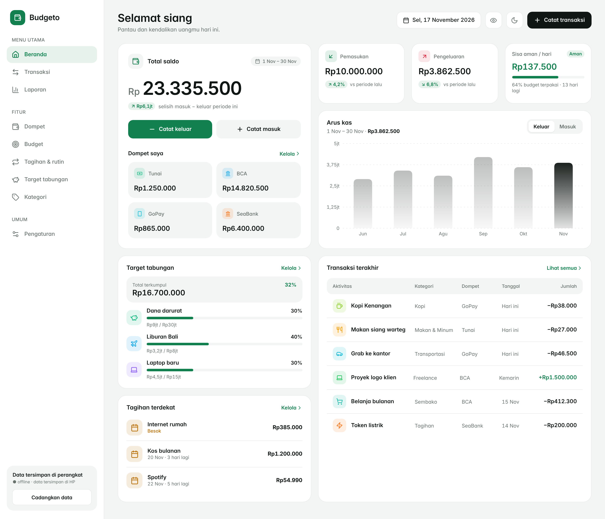
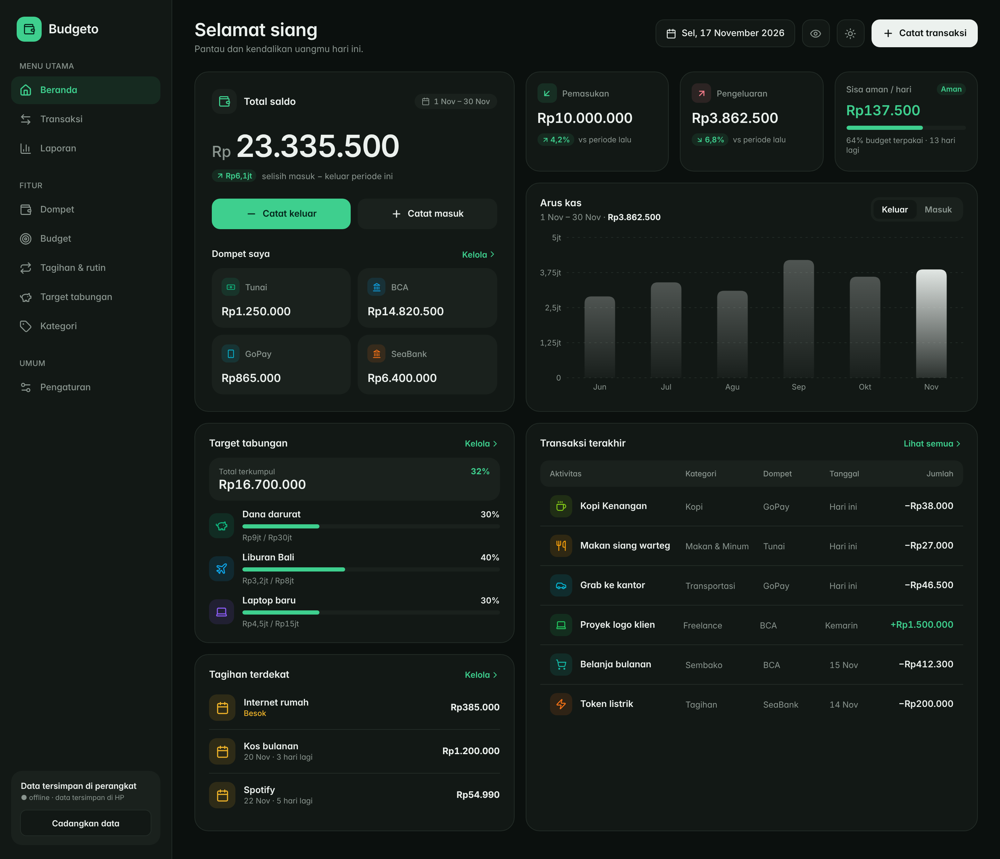
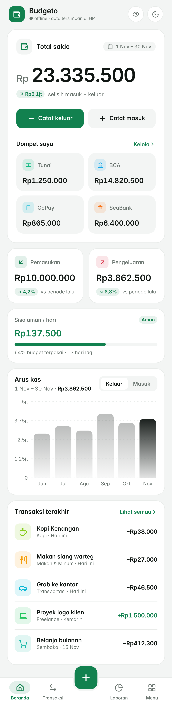
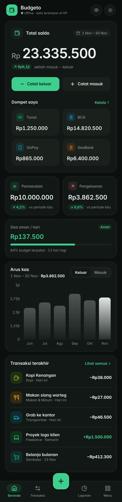
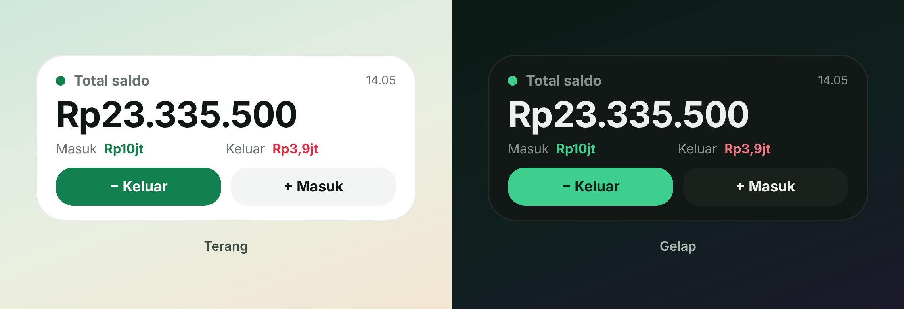
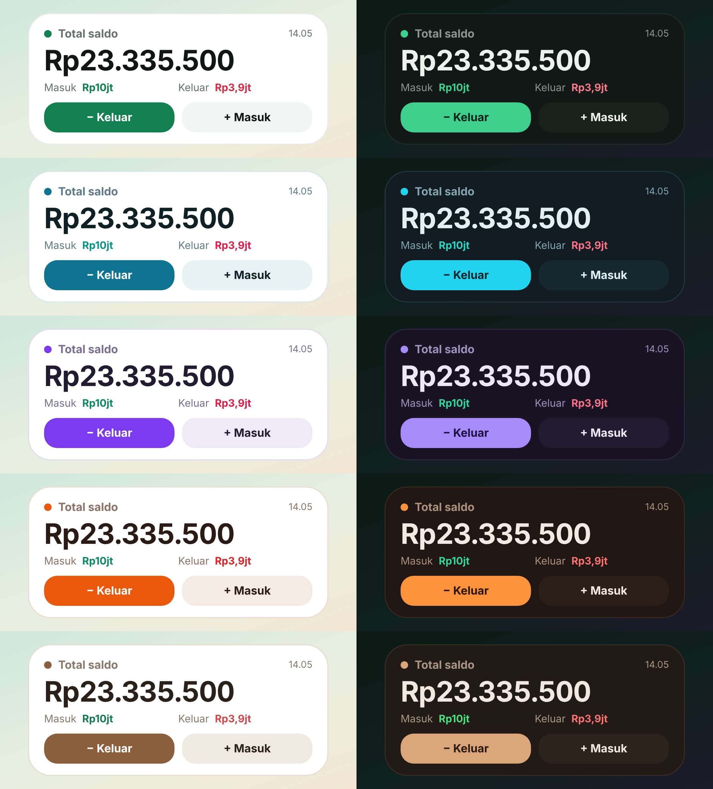
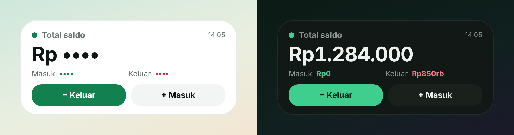

<p align="right">
  🌐 <a href="README.md">Bahasa Indonesia</a> • <b>English</b>
</p>

# 💰 Budgeto

> A modern, **offline-first**, **ad-free** personal finance manager designed for instant, private daily tracking that aligns with your real-world payday cycles.

<p align="left">
  <a href="https://github.com/avoocreator/budgeto/releases/latest">
    
  </a>
  <a href="#-tech-stack--technical-architecture">
    
  </a>
  <a href="#-tech-stack--technical-architecture">
    
  </a>
</p>

---

## 📌 Background

Many people want to routinely track their daily expenses, but give up along the way because existing finance apps often suffer from:

1. **Slow & Overly Dependent on the Internet:** Forcing account logins, displaying intrusive pop-up ads, or querying remote cloud servers while you are rushing in front of a store cashier or stranded in a location with weak connectivity.
2. **Rigid Budget Periods:** Restricting budgeting strictly to calendar months (1st to 30th/31st). In reality, paydays vary widely (e.g., the 25th), meaning the balance and remaining budget shown in conventional apps fail to reflect real day-to-day spending realities.
3. **Questionable Data Privacy:** Personal transaction histories and net worth records are frequently synced to third-party servers without clear user consent or transparency.
4. **Lack of Instant Glanceability:** Checking your remaining balance or logging a small expense usually requires unlocking and launching the full app rather than interacting directly with your smartphone's home screen.

**Budgeto** was built to solve these problems:
* **Frictionless 3-Tap Logging:** Launch the app or tap the widget, input the amount on a clean numeric keypad, select an automatically suggested category, and you're done.
* **100% Offline-First:** All financial data is stored securely on your local device storage (IndexedDB). No subscription paywalls, no ads, and full functionality even in airplane mode.
* **Daily Safe-to-Spend Allowance:** Mathematically calculates how much money you can safely spend each day until your next payday arrives.
* **Android Home-Screen Widget:** Brings your total balance, period summary, and quick transaction shortcuts directly to your home screen.

---

## 🖼️ User Interface Previews

Budgeto’s interface is crafted to be clean, calm, typography-focused (*tabular numerals* for precise number comparison), with native support for light and dark themes.

### 1. Desktop & Tablet View

The desktop layout leverages an expansive multi-column grid: total balance hero card and wallet breakdown on the left, paired with cash flow summaries, trend charts, and transaction records on the right.

| Light Mode | Dark Mode |
| :---: | :---: |
|  |  |

---

### 2. Mobile View

On mobile screens, information flows naturally in a vertical hierarchy: total balance hero at the top, followed by quick-add buttons, daily safe-to-spend budget indicators, 6-period cash flow, recent activities, savings goals, and upcoming bills.

| Mobile (Light) | Mobile (Dark) |
| :---: | :---: |
|  |  |

---

### 3. Android Home-Screen Widget & Color Themes

The 4x2 Android widget provides an instant view of your total balance, period flow, and transaction shortcuts without launching the app. The widget automatically mirrors the exact color scheme and tone selected in the app.

| Homescreen Widget | 5 Color Themes |
| :---: | :---: |
|  |  |

| Widget Status States |
| :---: |
|  |

---

## ✨ Key Features

### 📊 Smart Dashboard & Balance Focus
* **Total Balance Hero:** Displays your net available funds across all active wallets in a clean tabular font.
* **Safe-to-Spend per Day:** Calculates your daily allowance by dividing remaining budget by days left until payday, after deducting unpaid upcoming bills.
* **Cash Flow & 6-Period Trends:** Compares current income/expense against the prior period alongside an interactive 6-period bar chart.

### ⚡ Quick Add Transactions
* **Natural Numeric Keypad:** Fast transaction bottom sheet prioritizing amount entry without overwhelming form fields.
* **Smart Category Suggestions:** Analyzes historical frequency and note similarity to rank your most probable categories at the front.

### 🗓️ Flexible Payday Cycle (Payday Mode)
* Configure any payday between the 1st and the 31st.
* Automatically clamps to the last day of shorter months (e.g., a 31st payday shifts gracefully to February 28th/29th).
* Supports conventional calendar month cycles (1st to end-of-month) for users on traditional schedules.

### 👛 Multi-Wallet & Inter-Wallet Transfers
* Manage diverse funding sources: Cash, Bank Accounts, E-Wallets, and Savings.
* Balances are computed deterministically from transaction entries (income, expenses, and inter-wallet transfers).

### 🔔 Recurring Bills & Routines
* Track repeating payments (weekly or monthly) such as rent, internet, utilities, and digital subscriptions.
* **Auto-Post Mode:** Automatically logs the transaction on its due date.
* **Confirmation Mode:** Queues into a pending confirmation list with options to confirm, adjust the amount, or skip.
* Automatic D-1 reminder notifications before bill due dates.

### 🎯 Savings Goals
* Set specific savings targets with target deadlines.
* Log progress contributions with visual percentage indicators and celebration animations upon reaching your goal.

### 🎨 Theme Engine & Tone Control
* **5 Full Palette Schemes:** *Mocha* (warm), *Emerald* (fresh), *Aqua* (modern), *Sunset* (energetic), and *Lavender* (calm). Each includes dedicated light and dark variants.
* **Tone Temperature Slider:** Fine-tune atmosphere (-100 cool to +100 warm) injecting subtle tint across all surfaces.

### 🔒 Privacy Mode & Security
* **App Lock (PIN):** Secured via **PBKDF2** key derivation (WebCrypto API) with 100,000 iterations and random salt. The PIN is never saved in plain text.
* **One-Tap Privacy Mode:** Masks all numbers into `••••••` when in public places or taking screenshots.
* **Smart Auto-Lock:** Re-locks automatically when minimized or switching apps based on your chosen timeout.

### 📱 Android Home-Screen Widget
* Native 4x2 Android widget powered by `AppWidgetProvider` reading directly from `SharedPreferences`.
* Zero background network drain; updates instantly upon transaction mutation, midnight day-switch, or app launch.
* Deep link shortcuts (`budgeto://add?type=expense` & `budgeto://add?type=income`) opening transaction sheets directly from your home screen.

### 🌐 Data Portability & Optional Cloud Sync
* **Full JSON Export & Import:** Backup all transactions, categories, wallets, goals, and rules into a single local JSON file at any time.
* **CSV Export:** Download transaction mutations into standard spreadsheet format (Excel / Google Sheets).
* **Optional Cloud Sync (Supabase):** Optional multi-device synchronization powered by Supabase with Email OTP authentication and Row Level Security (RLS).

---

## 🚀 Getting Started & Installation

### 💻 1. Desktop & Laptop (Web & PWA)
Budgeto runs directly in any modern web browser without requiring software installation:
1. Open the Budgeto URL in your browser (Google Chrome, Microsoft Edge, Mozilla Firefox, or Brave).
2. **Install as a PWA (Recommended):** Click the **Install App** icon in the browser address bar.
3. Budgeto will be installed on your desktop with standalone windowing and app launcher shortcuts.

---

### 📱 2. Mobile Android (APK)

You do **not** need Android Studio or build tools. Android application packages (`APK`) are automatically compiled by GitHub Actions:

1. Open the latest releases page: **[Budgeto Releases (Latest)](https://github.com/avoocreator/budgeto/releases/latest)**.
2. Download the **`Budgeto.apk`** file.
3. Open the APK on your Android device and tap **Install** (allow *"Install unknown apps"* if prompted).
4. **Adding the Homescreen Widget:**
   * Long-press an empty space on your home screen.
   * Tap **Widgets**, search for **Budgeto**, and drag the **4x2** widget onto your screen.
   * Your total balance and quick-add buttons are now active on your home screen.

---

## 🛠️ Tech Stack & Technical Architecture

Budgeto is built with modern web technologies and packaged natively for Android via Capacitor:

<p align="left">
  <a href="https://nextjs.org/"></a>
  <a href="https://react.dev/"></a>
  <a href="https://www.typescriptlang.org/"></a>
  <a href="https://tailwindcss.com/"></a>
  <a href="https://dexie.org/"></a>
  <a href="https://capacitorjs.com/"></a>
  <a href="https://developer.android.com/"></a>
  <a href="https://www.framer.com/motion/"></a>
  <a href="https://supabase.com/"></a>
  <a href="https://bun.sh/"></a>
  <a href="https://github.com/features/actions"></a>
</p>

### 1. Frontend & UI Architecture
* **Next.js 16 (App Router):** Configured with static export (`output: 'export'`), allowing the entire web application to be bundled and served directly by the Android WebView without a Node.js server.
* **React 19 & TypeScript 5:** Strict type safety across financial calculation functions, reactive database hooks, and component states.
* **Tailwind CSS v4 & Semantic CSS Variables:** Uses runtime tokens (`var(--bg)`, `var(--surface)`, `var(--income)`, `var(--expense)`) orchestrated dynamically by the Theme Engine.
* **Framer Motion:** Powers fluid page transitions, spring physics for numpad interactions, and shared `layoutId` pill indicator morphing.

### 2. Offline Storage & Data Flow
* **Dexie.js (IndexedDB):** Serves as the single source of truth for all local entities (`transactions`, `categories`, `wallets`, `budgets`, `goals`, `recurringRules`, `settings`).
* **Reactive UI (`useLiveQuery`):** Automatically triggers component re-renders when data changes in IndexedDB without manual polling or state synchronization overhead.
* **Data Integrity:** All entities utilize client-generated UUIDs, `createdAt` & `updatedAt` timestamps, and soft-delete (`deleted: true`) for conflict-free local and cloud delta syncing.

### 3. Native Android Bridge & Widget (Capacitor + Java)
* **WidgetBridgePlugin (`Java`):** Custom Capacitor bridge pushing compressed JSON snapshots into Android `SharedPreferences` upon financial mutations.
* **BudgetoWidgetProvider (`AppWidgetProvider`):** Renders widget layouts via Android `RemoteViews`. Operates without network connectivity and reads directly from local cache for zero battery drain.
* **Deep Linking Integration:** Intercepts `budgeto://add?type=...` intents to trigger the transaction sheet immediately on launch.

### 4. Cryptography & Security
* **PBKDF2 Key Derivation:** Uses the WebCrypto API (`crypto.subtle`). User PINs are hashed using PBKDF2 with SHA-256 across 100,000 iterations and a cryptographically secure 16-byte salt.

### 5. Automated Build Pipeline (CI/CD)
* **GitHub Actions:** Defined in `.github/workflows/build-apk.yml`. Automatically configures JDK 21 and the Android SDK, exports the static Next.js bundle via Bun, syncs Capacitor assets, and compiles a debug APK published directly to GitHub Releases.

---

## 💻 Local Development Setup

To contribute or run Budgeto locally:

### Prerequisites
* [Node.js](https://nodejs.org/) (v20+) or [Bun](https://bun.sh/) (Recommended)
* [Git](https://git-scm.com/)

### Installation Steps

1. **Clone the repository:**
   ```bash
   git clone https://github.com/avoocreator/budgeto.git
   cd budgeto
   ```

2. **Install dependencies:**
   ```bash
   bun install
   ```

3. **Start the development server:**
   ```bash
   bun run dev
   ```
   Open [http://localhost:3000](http://localhost:3000) in your browser.

4. **Build production static export:**
   ```bash
   bun run build
   ```

5. **Sync with Android project (Optional):**
   ```bash
   bun x cap sync android
   bun x cap open android
   ```

---

<p align="center">
  Crafted with dedication by <a href="https://github.com/avoocreator"><b>Kira (Avoo Creator)</b></a><br />
  <i>"Understand your money, build better habits."</i>
</p>
