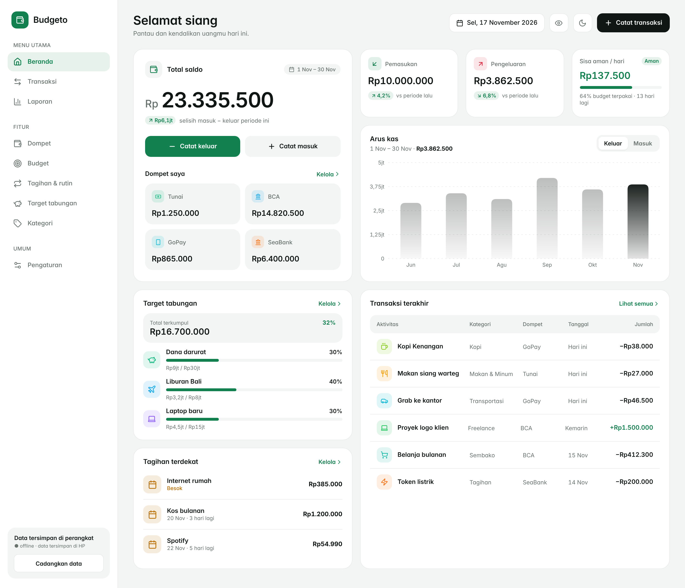
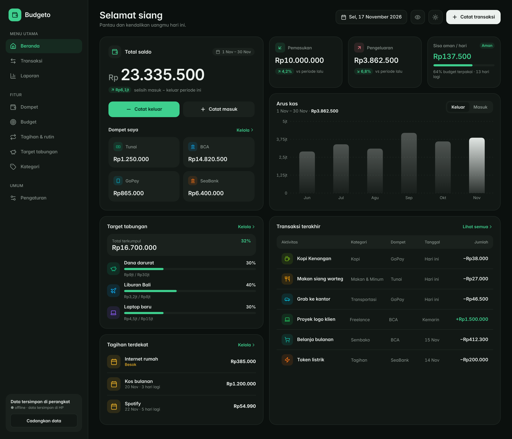
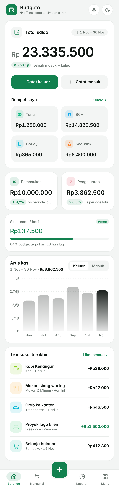
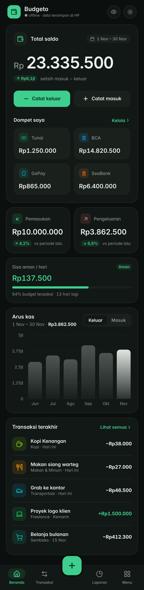
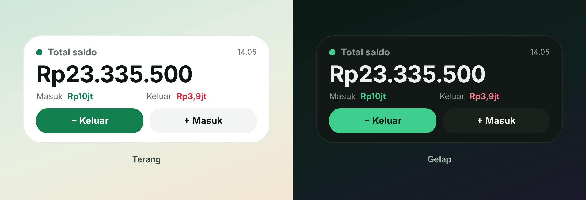
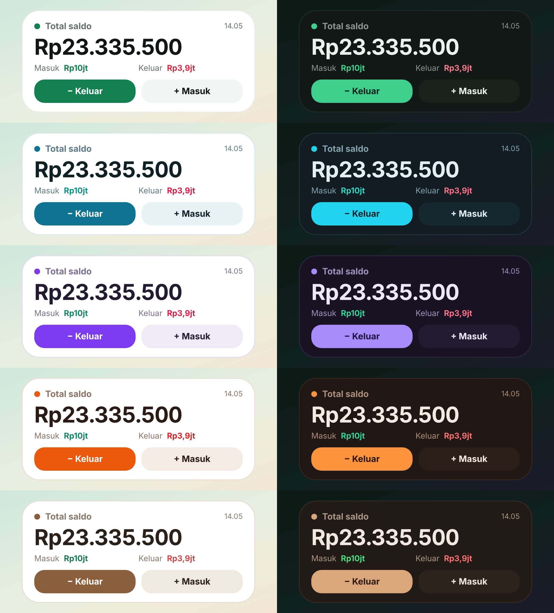
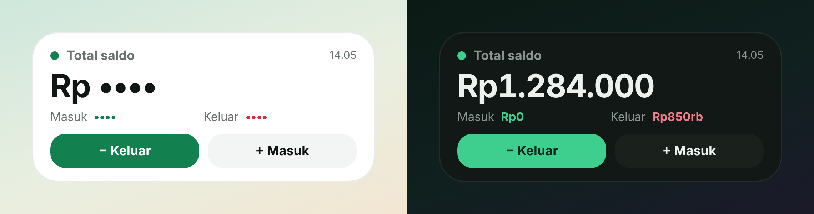

# 💰 Budgeto

> Aplikasi pengelola keuangan pribadi modern berbasis **offline-first**, **bebas iklan**, dan dirancang agar pencatatan uang harian berlangsung instan, privat, dan relevan dengan siklus gajian nyata.

<p align="left">
  <a href="https://github.com/avoocreator/budgeto/releases/latest">
    
  </a>
  <a href="#-tech-stack--arsitektur-teknologi">
    
  </a>
  <a href="#-tech-stack--arsitektur-teknologi">
    
  </a>
  <a href="#-tech-stack--arsitektur-teknologi">
    
  </a>
</p>

---

## 📌 Latar Belakang

Banyak orang ingin rutin mencatat pengeluaran, tetapi terhenti di tengah jalan karena aplikasi finansial yang ada sering kali:

1. **Terlalu Lambat & Bergantung pada Internet:** Mewajibkan login akun, menampilkan iklan pop-up, atau memuat data dari server cloud yang lambat saat pengguna sedang terburu-buru di depan kasir toko atau di tempat dengan sinyal minim.
2. **Siklus Anggaran yang Kaku:** Membatasi perhitungan anggaran hanya dari tanggal 1 sampai akhir bulan kalender. Padahal, sebagian besar orang menerima gaji di tanggal yang bervariasi (misalnya tanggal 25) sehingga saldo dan sisa anggaran di aplikasi tidak mencerminkan kenyataan keuangan harian mereka.
3. **Privasi yang Dipertanyakan:** Data transaksi pribadi dan catatan aset sering kali diunggah secara diam-diam ke server pihak ketiga tanpa transparansi.
4. **Informasi Tidak Terjangkau Cepat:** Mengetahui sisa uang atau mencatat pengeluaran kecil mengharuskan pengguna membuka aplikasi dari awal, bukan langsung dari layar beranda smartphone.

**Budgeto** lahir untuk menyelesaikan masalah tersebut:
* **Kecepatan Maksimal (3-Tap Record):** Buka aplikasi atau widget, masukkan nominal pada papan tombol besar, pilih kategori yang disarankan otomatis, dan selesai.
* **100% Offline-First:** Semua data finansial tersimpan aman di penyimpanan lokal perangkat pengguna (IndexedDB). Tidak ada biaya langganan, tanpa iklan, dan aplikasi tetap berjalan mulus di mode pesawat.
* **Sisa Aman Harian Sesuai Siklus Gajian:** Menghitung secara matematis berapa uang yang aman dibelanjakan setiap hari sampai tanggal gajian berikutnya tiba.
* **Widget Layar Utama Android:** Membawa informasi total saldo, ringkasan periode, dan tombol aksi cepat langsung ke layar utama ponsel pengguna.

---

## 🖼️ Pratinjau Antarmuka

Antarmuka Budgeto dirancang bersih, tenang, mengutamakan keterbacaan angka (*tabular numerals*), serta mendukung mode terang (*light*) dan mode gelap (*dark*).

### 1. Tampilan Desktop & Tablet

Tata letak desktop memanfaatkan grid multi-kolom yang luas: kartu saldo utama dan daftar dompet di sisi kiri, serta kartu ringkasan arus kas, grafik tren, dan tabel transaksi di sisi kanan.

| Mode Terang (Light) | Mode Gelap (Dark) |
| :---: | :---: |
|  |  |

---

### 2. Tampilan Ponsel (Mobile)

Pada layar vertikal, hierarki informasi ditata mengalir: fokus utama pada total saldo, disusul tombol aksi cepat catat keluar/masuk, status sisa anggaran per hari, arus kas 6 periode, transaksi terakhir, target tabungan, dan tagihan terdekat.

| Beranda Mobile (Light) | Beranda Mobile (Dark) |
| :---: | :---: |
|  |  |

---

### 3. Widget Layar Utama Android & Pilihan Tema

Widget Android 4x2 menyajikan total saldo secara jelas, indikator status ringkas, dan tombol pintasan transaksi tanpa perlu membuka aplikasi terlebih dahulu. Tampilan widget secara otomatis menyelaraskan warna latar dan tombol dengan skema tema yang dipilih di dalam aplikasi.

| Widget di Homescreen | 5 Skema Tema Warna |
| :---: | :---: |
|  |  |

| Varian Status Widget |
| :---: |
|  |

---

## ✨ Fitur Utama

### 📊 Dashboard Cerdas & Saldo Utama
* **Fokus Total Saldo:** Menampilkan total saldo riil dari seluruh dompet aktif dengan format tipografi tabular yang tegas.
* **Sisa Aman per Hari:** Menghitung jatah belanja harian yang aman berdasarkan sisa anggaran periode berjalan dibagi sisa hari menuju gajian, setelah dikurangi kewajiban tagihan yang belum dibayar.
* **Indikator Arus Kas & Tren 6 Periode:** Membandingkan pemasukan dan pengeluaran terhadap periode sebelumnya serta grafik batang interaktif 6 periode terakhir.

### ⚡ Catat Transaksi Super Cepat (Quick Add)
* **Papan Tombol Alami (Numpad):** Lembar pencatatan transaksi yang mengutamakan input nominal terlebih dahulu tanpa membebani pengguna dengan form panjang.
* **Saran Kategori Otomatis:** Sistem mendeteksi riwayat transaksi dan kemiripan catatan untuk merekomendasikan kategori yang paling sering digunakan pada urutan teratas.

### 🗓️ Siklus Periode Fleksibel (Payday Mode)
* Mendukung penentuan tanggal gajian dari tanggal 1 hingga 31.
* Menangani bulan-bulan pendek secara otomatis (misalnya gajian tanggal 31 otomatis bergeser ke hari terakhir di bulan Februari).
* Mendukung mode kalender standar (tanggal 1 s/d akhir bulan) bagi pengguna yang memilih siklus bulanan konvensional.

### 👛 Manajemen Multi-Dompet & Transfer
* Kelola berbagai sumber dana: Tunai, Rekening Bank, E-Wallet, dan Tabungan.
* Saldo dompet dihitung secara matematis dari mutasi transaksi (pemasukan, pengeluaran, dan transfer antar-dompet).

### 🔔 Tagihan & Rutinitas (Recurring Bills)
* Atur pengeluaran atau pemasukan rutin (mingguan atau bulanan) seperti sewa kos, internet, listrik, dan langganan digital.
* **Mode Otomatis:** Transaksi tercatat otomatis saat hari jatuh tempo tiba.
* **Mode Konfirmasi:** Transaksi masuk ke antrean menunggu persetujuan pengguna, dengan opsi konfirmasi nominal, ubah jumlah, atau lewati.
* Pengingat notifikasi otomatis H-1 sebelum tagihan jatuh tempo.

### 🎯 Target Tabungan (Savings Goals)
* Tetapkan target tabungan beserta tenggat waktu yang diinginkan.
* Catat setoran tabungan secara bertahap dengan visualisasi persentase progres dan efek animasi perayaan ketika target berhasil dicapai.

### 🎨 Theme Engine & Tone Control
* **5 Skema Palet Penuh:** *Mocha* (hangat), *Emerald* (segar), *Aqua* (modern), *Sunset* (enerjik), dan *Lavender* (tenang). Masing-masing skema memiliki varian terang (*light*) dan gelap (*dark*).
* **Slider Temperatur Tone:** Pengatur temperatur visual (-100 dingin s/d +100 hangat) yang menyuntikkan tint warna halus ke seluruh permukaan antarmuka.

### 🔒 Keamanan & Mode Privasi
* **Kunci Aplikasi (PIN):** PIN diamankan menggunakan fungsi derivasi kunci **PBKDF2** (WebCrypto API) dengan 100.000 iterasi dan salt acak unik. PIN asli tidak pernah disimpan dalam bentuk teks polos (*plain text*).
* **Mode Privasi Satu Ketukan:** Sembunyikan seluruh angka nominal menjadi `••••••` saat berada di tempat umum atau saat berbagi tangkapan layar.
* **Auto-Lock Cerdas:** Aplikasi otomatis mengunci kembali saat diminimalkan atau beralih aplikasi sesuai jeda waktu yang dipilih.

### 📱 Android Home-Screen Widget
* Widget native Android berukuran 4x2 yang membaca data terkompresi langsung dari `SharedPreferences`.
* Memperbarui informasi secara instan setiap ada perubahan transaksi, saat pergantian hari, maupun saat aplikasi dibuka.
* Mendukung *deep linking* (`budgeto://add?type=expense` & `budgeto://add?type=income`) untuk langsung membuka lembar pencatatan dari layar beranda ponsel.

### 🌐 Portabilitas Data & Sinkronisasi Opsional
* **Ekspor & Impor JSON Penuh:** Cadangkan seluruh data transaksi, kategori, dompet, target, dan tagihan ke dalam satu file JSON lokal kapan saja.
* **Ekspor CSV:** Unduh mutasi transaksi ke format spreadsheet (Excel / Google Sheets).
* **Opsional Cloud Sync (Supabase):** Bagi pengguna yang membutuhkan sinkronisasi lintas perangkat, tersedia integrasi opsional ke backend Supabase dengan autentikasi Email OTP dan *Row Level Security (RLS)*.

---

## 🚀 Cara Menggunakan & Instalasi

### 💻 1. Versi Desktop / Laptop (Web & PWA)
Budgeto dapat diakses langsung melalui peramban web modern tanpa perlu instalasi aplikasi tambahan:
1. Buka URL Budgeto di browser Anda (misalnya Google Chrome, Microsoft Edge, atau Mozilla Firefox).
2. **Pasang sebagai PWA (Sangat Disarankan):** Klik ikon **Install App** atau tanda unduh di address bar browser Anda.
3. Budgeto akan terpasang di komputer Anda layaknya aplikasi desktop mandiri (memiliki jendela sendiri dan pintasan di Desktop/Start Menu/Taskbar).

---

### 📱 2. Versi Ponsel Android (APK)

Anda tidak perlu mengompilasi kode sumber atau memasang Android Studio. Paket aplikasi Android (`APK`) dibangun secara otomatis oleh pipeline CI/CD GitHub Actions:

1. Buka halaman rilis resmi: **[Budgeto Releases (Terbaru)](https://github.com/avoocreator/budgeto/releases/latest)**.
2. Unduh file **`Budgeto.apk`**.
3. Buka file APK di ponsel Android Anda dan pilih **Install** (izinkan opsi *"Install unknown apps"* pada browser/file manager jika diminta).
4. **Memasang Widget di Homescreen:**
   * Tekan dan tahan area kosong di layar utama ponsel Anda.
   * Pilih menu **Widgets**, cari **Budgeto**, lalu seret widget **4x2** ke layar Anda.
   * Total saldo dan tombol pintasan transaksi kini siap digunakan langsung dari layar utama.

---

## 🛠️ Tech Stack & Arsitektur Teknologi

Aplikasi ini dibangun menggunakan arsitektur web modern yang dikemas ke lingkungan native Android menggunakan Capacitor:

<p align="left">
  <a href="https://nextjs.org/"></a>
  <a href="https://react.dev/"></a>
  <a href="https://www.typescriptlang.org/"></a>
  <a href="https://tailwindcss.com/"></a>
  <a href="https://dexie.org/"></a>
  <a href="https://capacitorjs.com/"></a>
  <a href="https://developer.android.com/"></a>
  <a href="https://www.framer.com/motion/"></a>
  <a href="https://supabase.com/"></a>
  <a href="https://bun.sh/"></a>
  <a href="https://github.com/features/actions"></a>
</p>

### 1. Frontend & Antarmuka Komponen
* **Next.js 16 (App Router):** Menggunakan static export (`output: 'export'`) sehingga seluruh bundle web dapat disajikan langsung oleh WebView lokal Android tanpa membutuhkan node server runtime.
* **React 19 & TypeScript 5:** Pengetikan kode ketat (*strict typing*) untuk menjamin konsistensi model data finansial, validasi kalkulasi, dan keandalan logika aplikasi.
* **Tailwind CSS v4 & CSS Variables:** Menggunakan sistem token semantik dinamis (`var(--bg)`, `var(--surface)`, `var(--income)`, `var(--expense)`) yang diatur langsung oleh Theme Engine saat runtime.
* **Framer Motion:** Mengelola animasi transisi halaman yang luwes, *spring physics* pada penekanan tombol numpad, serta animasi meluncur (*shared layoutId*) pada elemen navigasi tab.

### 2. Penyimpanan Offline & Arsitektur Data
* **Dexie.js (IndexedDB Wrapper):** Bertindak sebagai *single source of truth* untuk seluruh entitas lokal (`transactions`, `categories`, `wallets`, `budgets`, `goals`, `recurringRules`, `settings`).
* **Reaktivitas UI (`useLiveQuery`):** Antarmuka pengguna secara otomatis diperbarui seketika (*real-time*) setiap kali ada mutasi data pada database IndexedDB tanpa perlu pemanggilan manual `fetch` atau re-render yang boros.
* **Integritas Data:** Seluruh entitas memiliki UUID v4 unik, timestamp `createdAt` & `updatedAt`, serta menerapkan *soft-delete* (`deleted: true`) untuk mencegah hilangnya data secara tidak sengaja dan mendukung proses sinkronisasi delta.

### 3. Jembatan Native Android & Widget (Capacitor + Java)
* **WidgetBridgePlugin (`Java`):** Plugin kustom Capacitor yang menghubungkan JavaScript runtime ke lapisan sistem Android. Setiap kali data transaksi berubah, snapshot ringkas berformat JSON dikirim ke Android `SharedPreferences`.
* **BudgetoWidgetProvider (`AppWidgetProvider`):** Merender tata letak widget menggunakan Android `RemoteViews`. Widget tidak melakukan koneksi jaringan dan membaca data dari cache lokal secara instan, sehingga sangat hemat baterai.
* **Deep Linking Handler:** Menangkap intent URI scheme `budgeto://add?type=...` untuk membuka aplikasi dan langsung memunculkan lembar pencatatan transaksi yang relevan.

### 4. Kriptografi & Keamanan
* **PBKDF2 Password-Based Key Derivation:** Menggunakan standar kriptografi WebCrypto bawaan browser (`crypto.subtle`). PIN pengguna digabungkan dengan salt acak 16-byte kriptografis dan diulang sebanyak 100.000 iterasi hash SHA-256 sebelum diverifikasi.

### 5. Otomatisasi Kompilasi (CI/CD)
* **GitHub Actions Workflow:** Terkonfigurasi pada file `.github/workflows/build-apk.yml`. Setiap ada kode baru yang di-push ke branch `main`, runner Ubuntu akan menyiapkan JDK 21, Android SDK, mengekspor web statis via Bun, menyinkronkan aset Capacitor, dan mengompilasi APK debug siap pakai yang langsung dipublikasikan ke tab Releases.

---

## 💻 Menjalankan Proyek Secara Lokal

Bagi pengembang yang ingin berkontribusi atau menjalankan Budgeto di lingkungan lokal:

### Prasyarat
* [Node.js](https://nodejs.org/) (v20+) atau [Bun](https://bun.sh/) (Disarankan)
* [Git](https://git-scm.com/)

### Langkah Instalasi

1. **Clone repository:**
   ```bash
   git clone https://github.com/avoocreator/budgeto.git
   cd budgeto
   ```

2. **Pasang dependensi:**
   ```bash
   bun install
   ```

3. **Jalankan development server:**
   ```bash
   bun run dev
   ```
   Buka [http://localhost:3000](http://localhost:3000) pada browser Anda.

4. **Kompilasi build produksi web:**
   ```bash
   bun run build
   ```

5. **Sinkronisasi ke Android (Opsional, jika ingin mengedit kode Java):**
   ```bash
   bun x cap sync android
   bun x cap open android
   ```

---

## 📄 Lisensi

Proyek ini dirilis di bawah lisensi [MIT License](LICENSE). Bebas digunakan, dipelajari, dan dikembangkan lebih lanjut.

---

<p align="center">
  Dibuat dengan dedikasi oleh <a href="https://github.com/avoocreator"><b>Kira (Avoo Creator)</b></a><br />
  <i>"Kendalikan keuanganmu, bangun kebiasaan yang lebih baik."</i>
</p>
